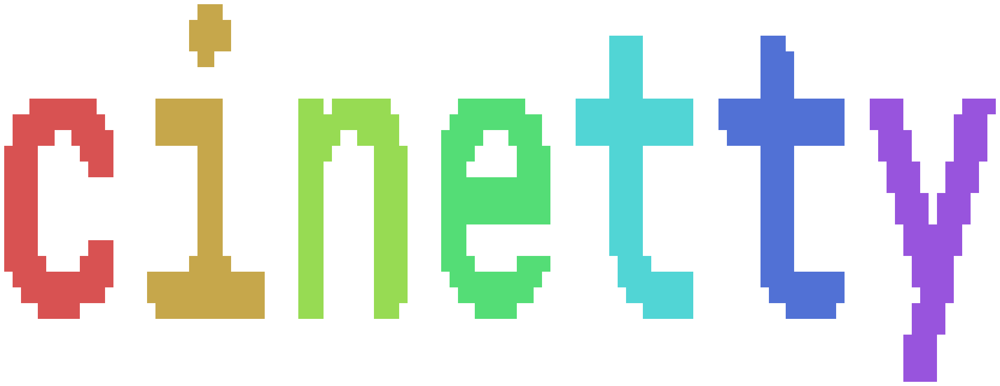
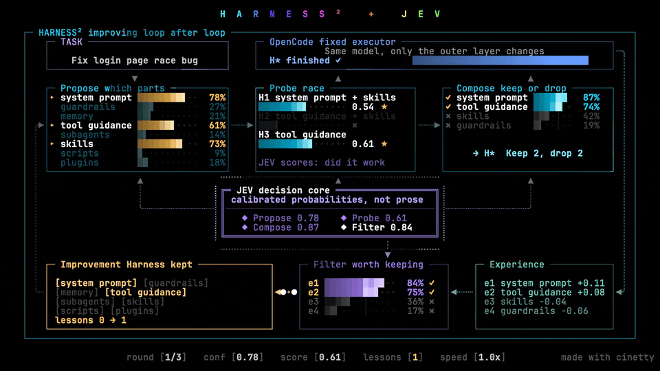
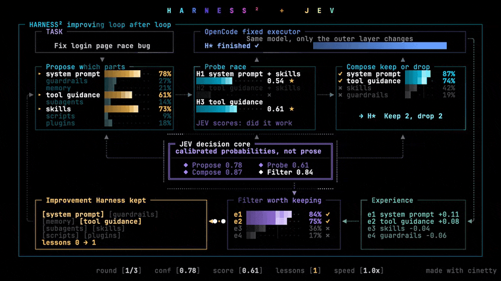
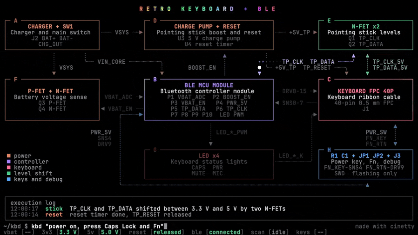
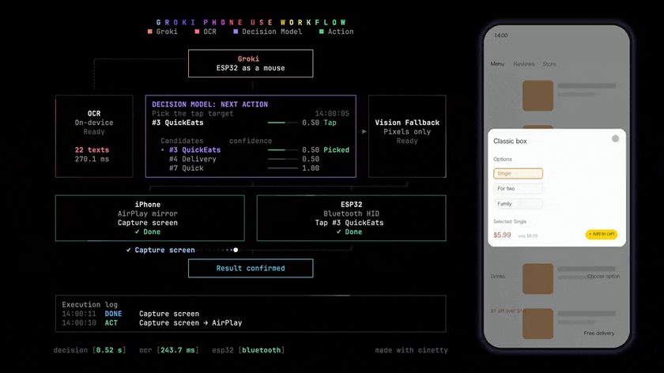
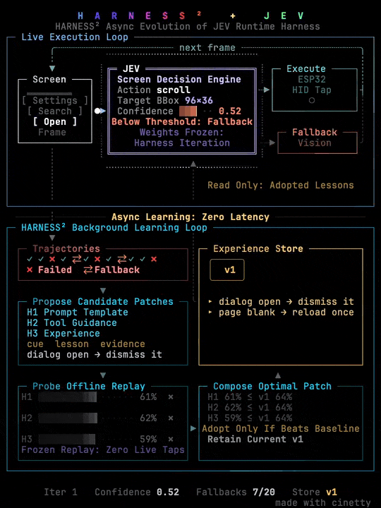
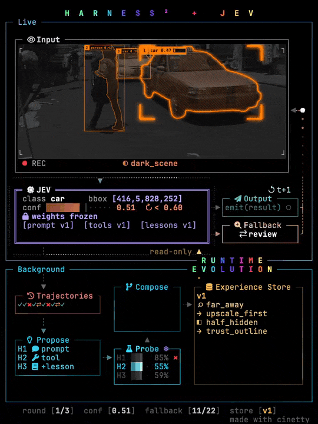
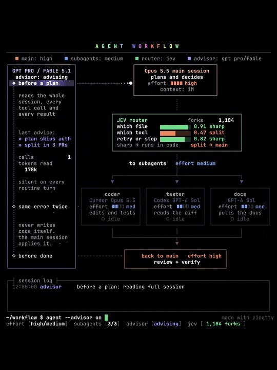

<p align="center">
  <b>English</b> | <a href="README.zh-CN.md">简体中文</a> | <a href="README.ja.md">日本語</a>
</p>

<p align="center">
  <p align="center"></p>
  <p align="center"><b>Cinematic architecture animations that play directly in your terminal.</b></p>
</p>

<p align="center">
  <a href="LICENSE"></a>
  <a href="https://www.python.org/downloads/"></a>
  <a href="https://github.com/JosssphZhou/cinetty"></a>
  <a href="https://x.com/openmys"></a>
</p>

<p align="center">
  <a href="docs/hero.mp4"></a>
</p>

<p align="center">
  Pick a template, describe your system in a single YAML file, check constraints, and watch your architecture come alive in terminal cells.
</p>

<p align="center">
  <a href="#templates-gallery">Templates Gallery</a> |
  <a href="#how-it-works">How It Works</a> |
  <a href="#requirements">Requirements</a> |
  <a href="#quick-start">Quick Start</a> |
  <a href="#use-it-as-a-skill">Use as a Skill</a> |
  <a href="#make-your-own">Make Your Own</a> |
  <a href="#license">License</a>
</p>

---

## Templates Gallery

<p align="center">
  <a href="templates/loop-landscape/"></a><br>
  <a href="templates/loop-landscape/"><code>loop-landscape</code></a>
</p>

<p align="center">
  <a href="templates/circuit-flow/"></a><br>
  <a href="templates/circuit-flow/"><code>circuit-flow</code></a>
</p>

<p align="center">
  <a href="templates/screen-flow/"></a><br>
  <a href="templates/screen-flow/"><code>screen-flow</code></a>
</p>

<p align="center">
  <a href="templates/loop-portrait/"></a><br>
  <a href="templates/loop-portrait/"><code>loop-portrait</code></a>
</p>

<p align="center">
  <a href="templates/photo-loop/"></a><br>
  <a href="templates/photo-loop/"><code>photo-loop</code></a>
</p>

<p align="center">
  <a href="templates/pipeline/"></a><br>
  <a href="templates/pipeline/"><code>pipeline</code></a>
</p>

Each preview illustrates the template in action. Click any card to inspect its template schema, scene configuration, and example project.

🎬 **10-Second Demo Clip**: [docs/hero.mp4](docs/hero.mp4)

---

## How It Works

cinetty is a template library for terminal animations, much like a curated pack of After Effects templates:

- **Pre-choreographed Motion**: Every template is a finished, polished animation featuring a fixed coordinate grid, cohesive color palette, engineered rhythm, and named content slots.
- **YAML-driven**: You only define your components, values, and timed events in a single YAML file. The layout stays locked and pixel-perfect.
- **Terminal-native & Protocol-aware**: The engine renders crisp animations directly onto terminal text cells. Photo templates integrate image assets via the Kitty graphics protocol.
- **Agent-first Workflow**: The easiest way to create an animation is letting your AI coding agent do the work. The agent inspects your codebase, selects the right template, writes the project YAML, runs `make check` until all layout constraints pass, and plays the result. Guidelines for coding agents are documented in [AGENTS.md](AGENTS.md).

---

## Requirements

- **Operating System**: macOS or Linux, with Bash and Make.
- **Terminal Support**: Any terminal for standard text templates. A terminal supporting the Kitty graphics protocol (such as Ghostty, Kitty, or WezTerm) is required for the photo template (`photo-loop`).
- **Runtime**: Python 3.12 or newer, or [uv](https://docs.astral.sh/uv/).
- **Disk Space**:
  - Text templates: `make setup` installs only the three lightweight packages needed for text rendering (about 73 MB, completed in seconds).
  - Photo template: `make setup-photo` adds PyTorch and two vision models (about 2 GB).
- **Optional Font (for Chinese text)**: Sarasa Term SC (`brew install --cask font-sarasa-gothic`) for optimal CJK terminal cell alignment. Without it, macOS falls back to default system CJK fonts.

---

## Quick Start

```sh
# Clone the repository and navigate into it
git clone https://github.com/JosssphZhou/cinetty.git cinetty && cd cinetty

# Fast setup: install text-template dependencies into .venv (about 73 MB)
make setup

# Play an example animation
make play INPUT=examples/circuit-flow/project.en.yaml
```

For the photo template (`photo-loop`), download the vision models first:

```sh
# Add PyTorch and vision models (about 2 GB)
make setup-photo

# Prepare the photos and play the photo example
make play INPUT=examples/harness-photo/project.en.yaml
```

### Controls & Tips

- **Stop Playback**: Press `Ctrl-C` at any time.
- **Looping**: Pass `LOOP=1` to repeat playback continuously (`make play INPUT=... LOOP=1`).
- **Preview Alias**: `make preview` is an alias for `make play`.
- **Terminal Sizing**: If the player warns about insufficient terminal cells, maximize your terminal window or decrease font size (`Cmd -`).
- **Screen Recording**: Record your terminal window directly using your preferred recording tool to generate video clips or GIFs.

---

## Use It as a Skill

The repository root includes `SKILL.md`, enabling the entire clone to operate as a native skill for Claude Code and OpenAI Codex. Install it into your tool's skills directory and run `make setup`; the agent will automatically invoke cinetty whenever you ask for an architecture animation. [AGENTS.md](AGENTS.md) contains the equivalent workflow for other agents.

| Environment | All Projects (Global) | Single Project Only |
|---|---|---|
| Claude Code | `~/.claude/skills/cinetty` | `.claude/skills/cinetty` in project root |
| Codex | `~/.agents/skills/cinetty` | `.agents/skills/cinetty` in project root |

```sh
git clone https://github.com/JosssphZhou/cinetty.git ~/.claude/skills/cinetty && make -C ~/.claude/skills/cinetty setup
```

> Directory structures verified on 2026-10-21 against [Claude Code skills](https://code.claude.com/docs/en/skills) and [Codex skills](https://developers.openai.com/codex/skills).

---

## Templates

Run the following command to view the catalog of all available templates:

```sh
make templates
```

| Template | Concept | Terminal Grid | Duration |
|---|---|---|---|
| [`loop-landscape`](templates/loop-landscape/) | An agent harness that improves itself over three rounds, scored by a decision core | 120 × 40 cells | ~35 s |
| [`loop-portrait`](templates/loop-portrait/) | A fast live decision loop on top, a slow learning loop below that improves it | 66 × 48 cells | ~37 s |
| [`photo-loop`](templates/photo-loop/) | A vision model reads real photos with live box effects while a background loop improves it | 66 × 48 cells (Kitty images) | ~36 s (28 s with two rounds) |
| [`pipeline`](templates/pipeline/) | A main agent plans, a router dispatches to one to three workers, an advisor steps in at three moments | 90 × 46 cells | 15 s per cycle |
| [`screen-flow`](templates/screen-flow/) | An agent operates a phone: OCR, a decision model, a pixel-only fallback, and two devices | 94 × 37 cells | 26 s |
| [`circuit-flow`](templates/circuit-flow/) | Eight modules light up as signals run along the wires between them | 120 × 40 cells | 44 s |

Each template directory contains:
- `template.yaml`: Field schema, definitions, types, and cell budget limits.
- `scene.yaml`: Layout definitions, coordinate bounds, and color slots.
- `preview/`: A still frame (`still.png`) and demo animation clip (`clip.gif` / `clip.mp4`).

Every template includes at least one complete example under `examples/`. See `examples/web-service/` for an adaptation of the circuit template to web microservices.

---

## Make Your Own

### 1. Pick a template
Run `make templates` and read `template.yaml` in your chosen template directory.

### 2. Create your project file
Copy an example project and replace the content with your own system definition:

```yaml
template: circuit-flow
template_version: 1
name: my-service
credit: false   # Optional: set to false to omit the "made with cinetty" footer
fields:
  title: MY SERVICE
  # ...
events:
  - {t: 3.0, type: light, box: A, until: 7.0}
  # ...
```

### 3. Check layout constraints
Validate that your text fits the allocated terminal cell budgets:

```sh
make check INPUT=my-service.yaml
```

Every issue identifies the exact field path and cell overflow:

```text
too_long: fields.modules.B.name (38 > 34): shorten to at most 34 cells (a CJK character counts as 2)
```

Widths are measured in terminal cells (a Chinese / CJK character counts as two cells). The checker never auto-truncates text for you.

### 4. Play it
Run the player in your terminal:

```sh
make play INPUT=my-service.yaml
```

Note that `screen-flow` renders the terminal board alone.

### Additional Guides
- **Localization**: One project file holds one language. To create a second language version, copy the YAML file and translate its string values.
- **Custom Layouts**: To customize visual layouts rather than content, see [docs/scene-reference.md](docs/scene-reference.md).
- **Architecture & Engine**: See [docs/design.md](docs/design.md) for how the engine components fit together.

---

## Author

Created by Joseph Zhou ([@openmys](https://x.com/openmys)).

Feedback, issue reports, and template contributions are welcome!

---

## License

- **Code and Templates**: MIT License (see [LICENSE](LICENSE)).
- **Sample Photos**: CC0 (Public Domain).
- **Pre-trained Models**: Apache-2.0 License.
- **Third-Party Assets**: Complete list of third-party assets and sources in [LICENSES.md](LICENSES.md).
